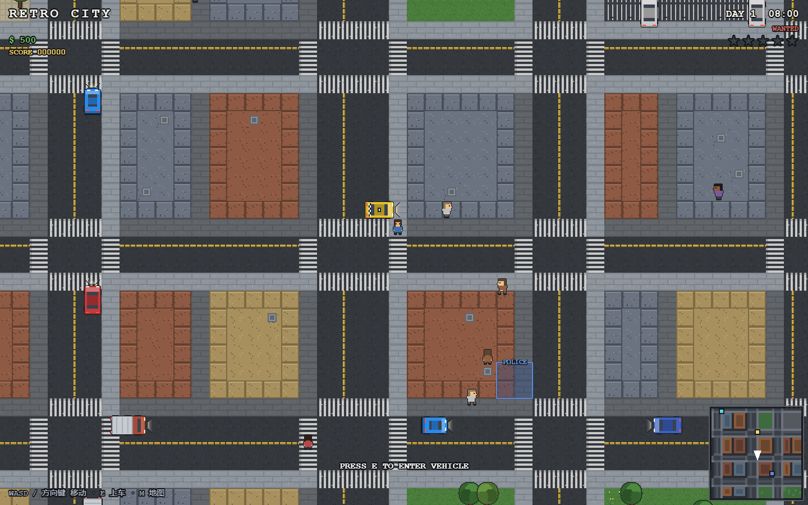
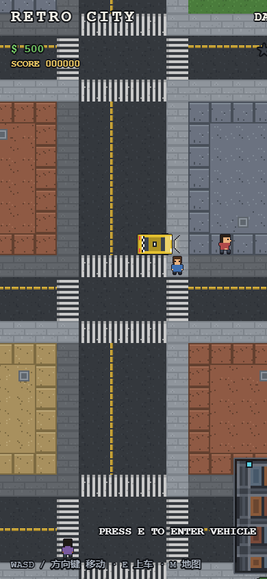

# Retro City

**中文** | [English](#english)

## 项目简介

Retro City 是一个运行在浏览器里的俯视角复古像素风城市沙盒，玩法参考经典 GTA：在程序化生成的城市里步行、抢车、犯罪、被警察追捕，并在小地图与导航的帮助下逃出生天。项目基于 **Phaser 3 + TypeScript + Vite**，全部美术资源由代码内的像素纹理工厂实时绘制，无外部素材依赖。

## 预览





## 功能

- **城市地图**：100 × 100 tile 程序化城市，包含道路、人行道、建筑、街区与碰撞体，摄像机平滑跟随角色。
- **人物移动**：WASD / 方向键四方向行走动画，建筑与道路碰撞检测；45 名 NPC 在城市中随机行走。
- **车辆系统**：多种车型拥有不同速度与操控手感，靠近按 E 上车、SPACE 手刹、E 下车；撞击行人、车辆与建筑均有反馈。
- **五级通缉系统**：抢劫车辆、撞击或攻击 NPC / 警察等犯罪行为会提升通缉星级，只有被警察目击才会计入通缉；等级越高，出动警车越多，2 星起警用无线电持续通报位置。
- **警察 AI 状态机**：PATROL（巡逻）/ ALERT（警戒）/ CHASE（追捕）/ INTERCEPT（拦截）/ ARRESTING（抓捕）/ SEARCH（搜索）六种状态由统一逻辑切换；警车沿道路 A* 寻路，不会穿墙直线冲撞。
- **拦截与抓捕**：警车提前抢占玩家前方拦截点，3 星以上多警车按楔形方位包围；玩家步行时警车停车放下步行警察实体追击。
- **双状态抓捕**：步行与驾驶分别使用不同的抓捕规则与进度条，脱离距离或重新加速可以打断并回退进度。
- **真实逃脱**：逃脱不依赖单一倒计时，需要同时脱离警察视野与距离，并熬过搜索阶段。
- **被捕结算**：罚款为现金的 20%（最低 100），车辆被扣押，通缉清零，在警察局复活，城市与 NPC 状态不被重置。
- **小地图与全地图**：右下角实时小地图显示玩家、警车、POI、现金包与导航路径；按 M 打开全城市地图，支持滚轮缩放、拖动平移、点击设置导航目标。
- **A\* 导航**：驾驶模式沿道路 tile 寻路，步行模式沿可行走掩码寻路，带视线平滑与自动重规划，HUD 显示距离与方向。
- **经济系统**：CASH 与 SCORE 两套完全独立的货币；NPC 被击败有概率掉落现金包，街头收益有窗口上限与恢复速率防刷；所有交易记录在 HUD 滚动显示，并通过 localStorage 节流存档。
- **城市 POI**：电话亭、武器店、维修站、车库、警察局等固定地标由固定种子生成。
- **音效**：代码合成的复古音效，包括警笛、引擎与交互提示，支持 N 静音、`[` `]` 调节音量。

## 快速开始

```bash
npm install
npm run dev      # 开发服务器
npm run build    # 类型检查 + 生产构建
npm run preview  # 预览构建产物
```

打开终端输出的本地地址即可开始游戏。

## 操作说明

| 按键 | 作用 |
| --- | --- |
| WASD / 方向键 | 步行移动 / 驾驶 |
| E | 上车 / 下车 |
| SPACE | 手刹 |
| M | 打开 / 关闭完整地图 |
| 鼠标滚轮 / 拖动 / 点击 | 地图缩放 / 平移 / 设置导航目标 |
| X | 取消导航 |
| N | 静音切换 |
| `[` `]` | 降低 / 提高音量 |
| ESC | 关闭地图 |

## 目录结构

```
retro-city/
├── index.html
├── src/
│   ├── main.ts                 # Phaser 游戏入口与场景注册
│   ├── config.ts               # 地图、玩家、警察、抓捕等全局配置
│   ├── data/
│   │   └── economyConfig.ts    # 金额、掉落概率、存档 key 等经济配置
│   ├── entities/               # Player / Vehicle / Police / Officer
│   ├── scenes/                 # BootScene / GameScene / HudScene / MapScene
│   └── systems/
│       ├── CityGenerator.ts    # 程序化城市生成
│       ├── PoliceManager.ts    # 警车调度与状态机
│       ├── PoliceInterceptionSystem.ts
│       ├── ArrestSystem.ts     # 抓捕进度判定
│       ├── BustSystem.ts       # 被捕结算与恢复
│       ├── WantedSystem.ts     # 五级通缉
│       ├── NavigationManager.ts# A* 导航
│       ├── MiniMapSystem.ts    # 小地图
│       ├── PlaceManager.ts     # 城市 POI
│       ├── CashPickupManager.ts
│       ├── EconomyManager.ts   # CASH / SCORE 统一接口
│       ├── WalletSystem.ts / ScoreSystem.ts
│       ├── NPCManager.ts / VehicleManager.ts
│       ├── TextureFactory.ts   # 代码绘制像素纹理
│       └── SfxFactory.ts       # 合成复古音效
└── docs/screenshots/
```

## License

MIT

---

<a id="english"></a>

# Retro City (English)

## Overview

Retro City is a top-down retro pixel-art city sandbox that runs in the browser, inspired by classic GTA: walk the procedurally generated streets, steal cars, commit crimes, get chased by the police, and escape with the help of a minimap and A* navigation. Built with **Phaser 3 + TypeScript + Vite**; every pixel-art texture and sound effect is generated in code, so there are no external asset dependencies.

## Preview


## Features

- **City map**: a 100 × 100 tile procedural city with roads, sidewalks, buildings, blocks and collision bodies, plus a smoothly following camera.
- **Character movement**: four-direction walking animation with WASD / arrow keys, building and road collision; 45 NPCs wander the city.
- **Vehicles**: several vehicle types with distinct speed and handling; press E near a car to enter, SPACE to brake, E to exit; impacts with pedestrians, cars and buildings give feedback.
- **Five-level wanted system**: stealing vehicles, hitting or attacking NPCs and police raise the wanted level, but only crimes witnessed by police count; higher levels bring more units, and from 2 stars the police radio continuously reports the player's position.
- **Police AI state machine**: PATROL / ALERT / CHASE / INTERCEPT / ARRESTING / SEARCH states switch through centralized logic; police cars path along the road network with A* instead of driving straight through walls.
- **Interception and arrest**: police cars claim interception points ahead of the player, and at 3+ stars multiple units surround the player in a wedge formation; when the player is on foot, cruisers stop and deploy foot officers.
- **Dual arrest rules**: on-foot and driving arrests use different rules and progress bars; breaking distance or accelerating away can interrupt and decay progress.
- **Realistic escape**: escaping is not a single countdown — you must break line of sight and distance, then survive the search phase.
- **Bust resolution**: a 20% cash fine (minimum 100), the vehicle is impounded, the wanted level is cleared, and the player respawns at the police station without resetting the city or NPCs.
- **Minimap and city map**: a live minimap shows the player, police cars, POIs, cash bags and the navigation path; press M for the full city map with wheel zoom, drag panning and click-to-navigate.
- **A\* navigation**: driving paths follow road tiles, walking paths follow the walkable mask, with line-of-sight smoothing and automatic re-planning; the HUD shows distance and direction.
- **Economy**: CASH and SCORE are fully independent currencies; defeated NPCs may drop cash bags, street earnings are capped by a recoverable budget to prevent farming, transactions scroll on the HUD and are throttled into localStorage saves.
- **City POIs**: phone booths, weapon shops, repair garages, garages and police stations are placed from a fixed seed.
- **Audio**: code-synthesized retro sound effects including sirens, engines and interaction cues; N mutes, `[` `]` adjust volume.

## Quick start

```bash
npm install
npm run dev      # dev server
npm run build    # type check + production build
npm run preview  # preview the build output
```

Open the local URL printed in the terminal to start playing.

## Controls

| Key | Action |
| --- | --- |
| WASD / Arrow keys | Walk / drive |
| E | Enter / exit vehicle |
| SPACE | Handbrake |
| M | Open / close the full map |
| Mouse wheel / drag / click | Zoom / pan / set navigation target |
| X | Cancel navigation |
| N | Toggle mute |
| `[` `]` | Volume down / up |
| ESC | Close the map |

## Project structure

```
retro-city/
├── index.html
├── src/
│   ├── main.ts                 # Phaser game entry and scene registration
│   ├── config.ts               # Map, player, police and arrest configuration
│   ├── data/
│   │   └── economyConfig.ts    # Money, drop chance and save-key settings
│   ├── entities/               # Player / Vehicle / Police / Officer
│   ├── scenes/                 # BootScene / GameScene / HudScene / MapScene
│   └── systems/
│       ├── CityGenerator.ts    # Procedural city generation
│       ├── PoliceManager.ts    # Police dispatch and state machine
│       ├── PoliceInterceptionSystem.ts
│       ├── ArrestSystem.ts     # Arrest progress logic
│       ├── BustSystem.ts       # Bust resolution and recovery
│       ├── WantedSystem.ts     # Five-level wanted system
│       ├── NavigationManager.ts# A* navigation
│       ├── MiniMapSystem.ts    # Minimap
│       ├── PlaceManager.ts     # City POIs
│       ├── CashPickupManager.ts
│       ├── EconomyManager.ts   # Unified CASH / SCORE interface
│       ├── WalletSystem.ts / ScoreSystem.ts
│       ├── NPCManager.ts / VehicleManager.ts
│       ├── TextureFactory.ts   # Code-drawn pixel textures
│       └── SfxFactory.ts       # Synthesized retro sound effects
└── docs/screenshots/
```

## License

MIT
